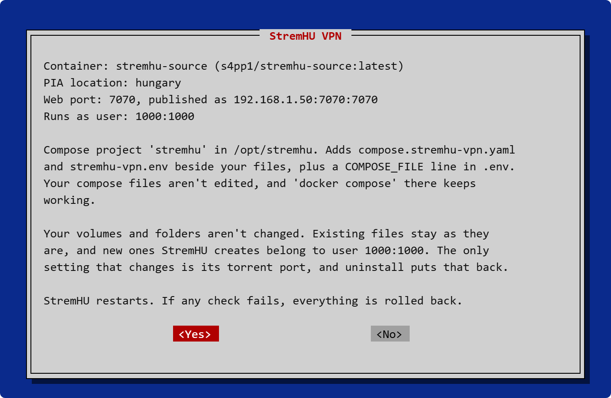
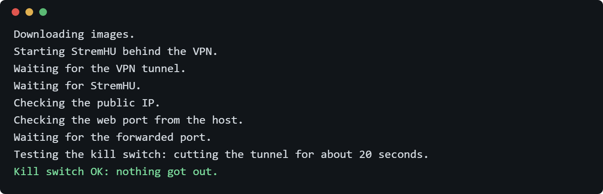
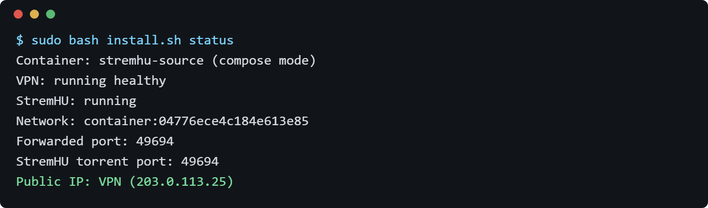

<p align="center">
  
</p>

<h1 align="center">StremHU VPN</h1>

<p align="center">
  <b>Put your existing StremHU behind a PIA VPN</b><br/>
  A guided installer that works with however you set StremHU up. Your volumes stay as they are, and one command puts
  everything back.
</p>

<p align="center">
  <a href="https://github.com/pbalazs123/stremhu-vpn/tags"></a>
  <a href="LICENSE"></a>
  
  
  
</p>

<p align="center">
  <a href="#-features">Features</a> •
  <a href="#-screenshots">Screenshots</a> •
  <a href="#-quick-install">Quick Install</a> •
  <a href="#-how-it-works">How It Works</a> •
  <a href="#-uninstall">Uninstall</a> •
  <a href="#-troubleshooting">Troubleshooting</a>
</p>

---

## ✨ Features

| | |
|---|---|
| **Works with your setup** | Reads the file names, service, port, user and networks from Docker, so custom Compose files and `docker run` both work |
| **Torrents through the tunnel** | PIA WireGuard with a kill switch and automatic port forwarding |
| **Web access stays the same** | The same port on the same address, public or behind NAT |
| **Your volumes stay untouched** | It never writes to them, moves them or changes who owns the files |
| **Guided setup** | Dialog screens like a Debian install. It adds the dialog package if it's missing |
| **Rolls back on failure** | It tests the result, including cutting the tunnel on purpose, and puts the original back if a check fails |
| **Removable** | One command restores your original setup |

---

## 📸 Screenshots

<p align="center">
  <br/>
  <i>The summary: what it found and exactly what it will do. Nothing changes until you choose Yes</i>
</p>

<p align="center">
  <br/>
  <i>The install tests itself, kill switch included</i>
</p>

<p align="center">
  <br/>
  <i>Check it any time with the status command</i>
</p>

## 📦 Quick Install

You need:

- StremHU Source already running, on Linux
- A PIA subscription
- Docker with Compose 2.24 or newer
- Root or `sudo`

Run this on the machine with StremHU, from any folder:

```bash
curl -fsSL https://raw.githubusercontent.com/pbalazs123/stremhu-vpn/main/install.sh -o install.sh
sudo bash install.sh
```

The installer finds StremHU, asks for your PIA login and location, then shows a summary. It takes about 2 minutes after
you confirm.

```bash
sudo bash install.sh status      # current state
```

---

## 🎯 How It Works

1. **Find.** It reads StremHU's settings from Docker.
2. **Connect.** A VPN container joins your networks, and StremHU moves inside that container's network.
3. **Forward.** StremHU's torrent port follows PIA's forwarded port automatically.
4. **Test.** It checks the tunnel, public IP, web port and forwarded port, then cuts the tunnel to prove nothing gets out.

| Your setup | What the installer does |
|---|---|
| A Compose folder it can reach | Adds `compose.stremhu-vpn.yaml` and `stremhu-vpn.env` beside your files, plus marked lines in `.env`. Your Compose files aren't edited, and `docker compose` keeps working |
| `docker run`, Portainer, Dockhand, Unraid and similar | Creates a new stack in `/opt/stremhu-vpn` from the container's real settings, and keeps the old container stopped as `NAME-pre-vpn` |

### 🔒 Your volumes

The installer never writes to, moves, changes ownership of or deletes anything in your StremHU volumes or folders. It only
ever removes its own two volumes, `stremhu-vpn-pia` and `stremhu-vpn-pia-shared`.

- **New files:** anything StremHU creates behind the VPN belongs to user 1000, or to your own user if you already set one.
- **Torrent port:** StremHU's setting moves to PIA's port, and uninstall puts the old value back.

### 🚧 Limits

- It only works with PIA, on Linux, and doesn't support Docker Swarm.
- With Portainer, Dockhand, Unraid and similar tools, remove StremHU from that tool, or a redeploy starts it **without the VPN**.
- Clients on the web port see your server's IP. The VPN protects torrenting, not web access.
- StremHU's automatic DDNS can't update your IP while it's behind the VPN. With a dynamic IP, use another updater, such as your router's.
- It relies on StremHU's internals, so a StremHU update could break it.

### 🧪 Testing

Tested on one Debian 13 server on 2 November 2026: official and heavily customised Compose files, `docker run`, the real
dialogs, a wrong password, a forced failure, a killed install, the kill switch and uninstall.

**Not tested:** Portainer, Dockhand and Unraid; other distributions; installing the dialog package; plain-text prompts; old
Compose versions; a real internet client and router port forward; real DDNS; real downloads and playback; a reboot or power
cut during the install.

---

## 🔄 Uninstall

```bash
sudo bash install.sh uninstall
```

| Item | After uninstall |
|---|---|
| Your Compose files | Never edited, so unchanged |
| `.env` | Only the installer's lines are removed |
| Added files, containers, network and VPN volumes | Removed |
| A `docker run` container | The original comes back, with its name and restart setting |
| Torrent port setting | Back to the old value |
| Your volumes | Untouched. Files created behind the VPN stay |

The dialog package stays installed, because other programs may use it.

---

## 🐛 Troubleshooting

**"PIA rejected that username or password"?** Use your PIA account login, the one starting with `p`. Nothing was changed.

**"No StremHU Source container was found"?** Start StremHU first. If you built your own image, add `--container NAME`.

**"Docker Compose 2.24 or newer is needed"?** Update Docker's Compose plugin and run it again. Nothing was changed.

**"The VPN didn't connect within 3 minutes"?** It rolled back. Try another location, and check that the machine allows
WireGuard.

**A warning about the torrent port?** Create StremHU's admin user. The port is set within 30 seconds after that.

**`status` says WARNING on the public IP line?** StremHU isn't behind the VPN. The usual cause is that something restarted
the old setup.

**Anything else?** The full log is at `/var/log/stremhu-vpn-install.log`.

---

## 🙏 Acknowledgments

- [thrnz/docker-wireguard-pia](https://github.com/thrnz/docker-wireguard-pia) for the VPN container
- [adrianmihalko/stremhu-pia-helper](https://github.com/adrianmihalko/stremhu-pia-helper) for the idea of setting the port through StremHU's API

StremHU VPN is unofficial and not affiliated with [StremHU Source](https://github.com/s4pp1/stremhu-source) or Private Internet Access.

## 📄 License

[MIT](LICENSE)

<p align="center"><a href="https://github.com/pbalazs123/stremhu-vpn/issues">Report a problem</a></p>
